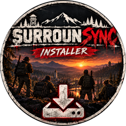

<p align="center">
  
</p>

<h1 align="center">SurrounSync</h1>

<p align="center">
  Co-op for SurrounDead. Play together over Steam, no server or port forwarding needed.<br>
  <a href="https://github.com/SYMPLYSCK/SurrounSync/releases/latest">Download</a> ·
  <a href="CHANGELOG.md">Changelog</a> ·
  <a href="#troubleshooting">Help</a>
</p>

---

SurrounSync is a [UE4SS](https://github.com/UE4SS-RE/RE-UE4SS) mod that adds two-player co-op to SurrounDead.
Both of you run the normal single-player game, and the mod keeps the two games in sync: the other player, the
zombies and AI, loot, doors, cars, weather and so on.

- **Bring your own character.** You join your friend's world with your own gear and inventory, and when you
  leave you go back to your own world with whatever you picked up.
- **Same fight on both screens.** The host's zombies, bandits, soldiers, bosses and animals are the real ones and
  the guest sees exact copies. Hits, kills, loot, damage, bleeding and infection all count on both sides.
- **Your saves are safe.** Your own world is saved and backed up before you join, and it's never touched while
  you're away. See [Save safety](#save-safety).

## Requirements

- SurrounDead on Steam (each player their own copy), Windows 10 or 11, Steam running and logged in.
- A PC that runs SurrounDead smoothly on its own. The mod itself adds about 1 ms per frame and a few MB of memory.
- 16 GB of RAM recommended, and at least 2 GB free on the drive your saves are on (for backups).
- Internet: under 0.5 Mbit/s each way. Ping matters more than speed: players in the same region get the
  smoothest game, and across continents it still works with a little delay. Wired or good Wi-Fi helps. No ports
  to open.
- The host's PC runs all the AI for both players, so let the faster PC host.
- BOTH PLAYERS MUST BE ON 0.8 EXPERIMENTAL!

## Install

Both players need the same SurrounSync version.

1. Close SurrounDead.
2. Download **SurrounSyncSetup.exe** from the [latest release](https://github.com/SYMPLYSCK/SurrounSync/releases/latest) and run it.
3. Click **INSTALL**. It finds the game on its own (or use *Browse*), installs UE4SS if you don't have it yet, the
   mod, and optionally the PDS blood and gore mod.

When it's done, the setup checks your PC and tells you if anything is off, with what to do about it. You can run
that check again any time with the **Check** button.

To uninstall, use *Settings → Apps → SurrounSync* or the *Uninstall* button in the setup. It removes what it
installed and nothing else. Your saves and backups stay.

## Play

1. Start SurrounDead through Steam and load one of your saves.
2. Press **J** to open the handbook and go to the **CO-OP** tab. Your **friend code** is shown there.
3. One of you clicks **HOST A GAME**.
4. The other one clicks **JOIN** next to the host's name, or types the host's friend code under **JOIN WITH A
   CODE**, or picks a public game.
5. The host gets a pop-up and a sound, and accepts the request in their CO-OP tab.
6. The guest's game saves and then loads into the host's world, right next to them.
7. To go home, click **LEAVE CO-OP** (or press **Ctrl+F10**). You end up where you were when you joined.

You don't need to restart to switch roles. Once you're back home you can host, and a host with nobody in their
world can join someone else.

## What's synced

| | |
|---|---|
| **Players** | movement, sprinting, crouching, clothes and gear, weapons, aiming, animations, flashlights and lasers, a name tag with connection quality |
| **Combat** | shots, impacts, blood and gore (with PDS), grenades and projectiles, hits and kills, damage and medical effects (bleeding, infection, radiation) |
| **AI** | zombies, bosses, bandits, soldiers, scavengers and animals: looks, movement, health, deaths, corpses. XP goes to whoever made the kill |
| **Loot** | corpses, containers, storage and crates, dropped items, death bags. Guns keep their magazines and attachments |
| **World** | time and weather, doors, building, generators and lights, cars (driving, passengers, fuel, damage) |
| **Your character** | inventory and quest progress go with you into the co-op world and back, beds in both worlds |
| **Other** | chat, passwords, public games, voice chat (experimental) |

## Keys

| Key | |
|---|---|
| **J** → CO-OP | co-op menu |
| **Ctrl+F10** | leave the host's world |
| Ctrl+H, Ctrl+1–3 | host / join a hosting friend, if the menu won't open |
| Ctrl+F11 | write an inventory report to the log |
| Ctrl+F12 | write the connection status to the log |

## Updates

When a new version is out, the game tells you and the CO-OP tab shows **UPDATE TO x.y.z**. Click it, close the
game, and it installs itself. The setup can also download the newest version. If you and your friend are on
different versions, the mod tells you when you connect.

## Bug reports

If something goes wrong, click **BUG REPORT** in the CO-OP tab (or open *SurrounSync Bug Report* from the Start
menu if the game won't start). It packs up the logs and the latest crash report and sends them to me, and also
saves a copy on your desktop as `SurrounSync-report-<date>.zip`. Nothing is ever sent unless you click the button.

The report has no save files in it. The logs do include your Windows user name (it's in file paths) and the Steam
names and IDs of you and the person you played with. If sending fails, you can send the zip from your desktop
yourself. A line about what you were doing when it broke helps a lot.

## Save safety

- Before you join, your game is saved and the save is checked on disk. Every time co-op touches a save, a full
  copy goes to `%LOCALAPPDATA%\SurrounDead\Saved\SurrounSyncBackups`. The last 10 are kept for each save, plus the
  very first one from before you ever used co-op, which is never deleted.
- To restore one, go to the CO-OP tab → **BACKUPS**. It's applied the next time you start the game, and your
  current save is backed up first.
- While you're in someone else's world you play in a separate co-op save, never in your own. Your own save only
  gets your character back when you leave, and only if it hasn't changed since you joined.
- If the game crashes, you quit, or you load another save mid-session, your character goes home as of the last
  co-op save. The games also save a few seconds after items change hands. If the host's game closes, you're sent
  home after 30 seconds.
- Saves are written to a temporary file first and swapped in when complete, so a crash can't leave half a save.

## Troubleshooting

Run **SurrounSync Setup → Check** first. It catches most problems and tells you how to fix them.

| Problem | Fix |
|---|---|
| No CO-OP tab | Usually an old game version: update SurrounDead in Steam (Properties → Betas → None, then Verify integrity of game files), then run the setup's REPAIR. A different UE4SS version from another mod can also cause it. |
| "The Steam connection isn't running" | Start Steam before the game. If it's running, your antivirus may have removed `SurrounSyncBridge.exe`. Restore it, allow it, and run REPAIR. |
| Friend isn't listed | They have to click **HOST A GAME** first, or you can use their friend code. |
| "Different version of SurrounSync" | Both of you update to the newest version. |
| Game crashes at start after a game update | Probably an old `.pak` mod in `Content\Paks\~mods`. Move it out of the `Paks` folder. |
| Anything else | Send a [bug report](#bug-reports). |

## Known limitations

- Two players per session.
- Traders and quests aren't synced yet, and zombies only hear the other player's gunshots and explosions.
- Mods that change the same systems (other co-op or inventory mods) haven't been tested. The CO-OP tab lists mods
  that differ between you and your friend.

## How it works

Each game stays single-player. The mod sends what changes between the two games: player positions 30 times a
second, zombie snapshots 15 times a second, and events like shots, hits, loot and doors as they happen.
`SurrounSyncBridge.exe` carries this over Steam's peer-to-peer networking. When the guest joins, the host's world
save is sent over and the guest loads it with their own character. The host's game runs all the AI, the guest's
copies follow along, and the guest's hits are applied to the host's zombies.

More detail in [docs/ARCHITECTURE.md](docs/ARCHITECTURE.md).

## Building

```
mod/SurrounSync/   the mod as it goes into ue4ss/Mods (Lua scripts and the built bridge)
bridge/            SurrounSyncBridge (Steam networking) and code shared with the setup
installer/         SurrounSyncSetup.exe and its icon
tools/             build, release, tests, lint and a one-PC test setup
docs/              how it works, development notes
```

Building and testing: [docs/DEVELOPMENT.md](docs/DEVELOPMENT.md).

## License

© 2026 Jayden Munroe. All rights reserved. The code is public so you can see how it works, but it isn't free to
reuse: please don't copy, modify or redistribute it without asking. Playing it and reporting bugs is always
welcome. See [LICENSE](LICENSE).

## Credits

- [UE4SS](https://github.com/UE4SS-RE/RE-UE4SS), the scripting runtime this is built on (MIT licence, included in
  the setup).
- PDS (Procedural Damage System), the blood and gore mod the setup offers alongside it.
- SurrounSync is an unofficial fan mod. It isn't affiliated with or endorsed by the developers of SurrounDead.
